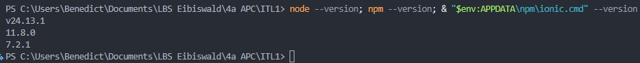
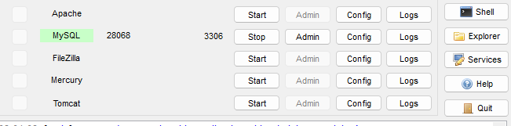
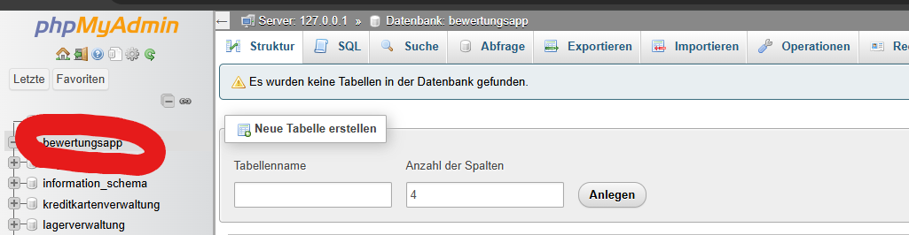

# Einheit 1 – Installation und allgemeine Fragen

Benedict Jaros, 4a APC

## Screenshots

## Fragen

### 1. Capacitor vs. Cordova

Beide machen aus einer WebApp eine Android oder iOS App. Capacitor ist neu von Ionic.

### 2. ORM wie Sequelize, wofür zusätzlich die sequelize-cli

Ein ORM macht aus Tabellen Objekte und aus Methodenaufrufen SQL, so muss man kein SQL selber
schreiben. Die `sequelize-cli` verwaltet die Migrationsdateien, damit jeder dieselbe Datenbank
hat.

### 3. `npm install` vs. `npx`

`npm install` lädt ein Paket herunter und speichert es dauerhaft, damit man es im Projekt
benutzen kann. `npx` führt ein Paket nur einmal aus, ohne es zu installieren.

### 4. Was ist REST, warum passt es zu Ionic + Node

REST heißt, man arbeitet mit den HTTP-Methoden auf URLs, z.B. GET zum Lesen und POST zum
Anlegen, und bekommt JSON zurück. Das passt zu Ionic und Node, weil die App nur die Endpunkte
kennen muss und nichts über die Datenbank weiß.
